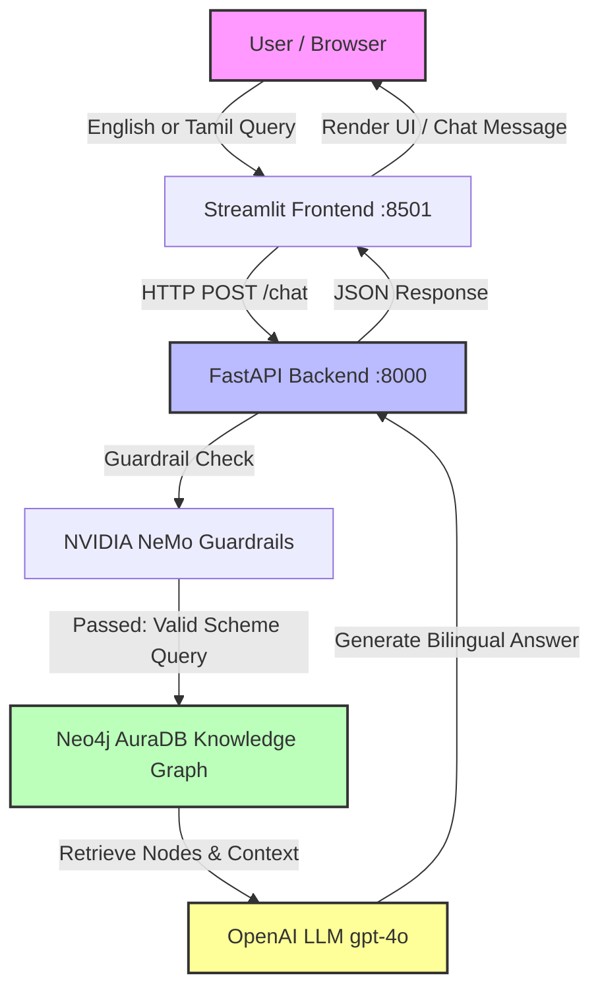

# 🏛️ Tamil Nadu Government Schemes AI Assistant

An intelligent, bilingual (English & Tamil) GraphRAG-powered conversational assistant designed to help citizens, farmers, students, and women easily discover Tamil Nadu government welfare schemes, eligibility rules, and financial aids.

---

## 🌟 Project Description

Navigating government welfare programs can often be complex. This project bridges the gap by leveraging a **Knowledge Graph (Neo4j AuraDB)** combined with **Large Language Models (OpenAI GPT-4o)** to provide precise, verified information about various Tamil Nadu government departments and schemes. To ensure safety and domain relevance, the application integrates **NVIDIA NeMo Guardrails** to restrict conversations strictly to government welfare topics.

---

## 🏗️ Architecture & Flow Graph

The following diagram illustrates how user requests flow through the end-to-end architecture:



---

## 🚀 Key Features

1. **Bilingual Support:** Seamlessly switch between English and Tamil interfaces and responses.
2. **GraphRAG Architecture:** Pulls structured data from a Neo4j cloud database storing departments, schemes, categories, eligibility criteria, and benefits.
3. **Safety Guardrails:** Uses NVIDIA NeMo Guardrails to block off-topic or inappropriate inquiries.
4. **Interactive UI:** Built with Streamlit for a clean, responsive chat experience.
5. **High-Performance API:** Powered by an asynchronous FastAPI backend.

---

## 📁 Project Directory Structure

```text
TamilNadu_Government_Schemes_AI_Assistant_project/
│
├── backend/
│   ├── guardrails_config/
│   │   ├── config.yml
│   │   └── rails.co
│   └── main.py              # FastAPI application server
│
├── frontend/
│   └── app.py               # Streamlit web interface
│
├── scripts/
│   └── ingest_data.py       # Data scraper & Neo4j graph loader
│
├── .env                     # Environment credentials (API keys, URIs)
├── requirements.txt         # Project Python dependencies
└── README.md                # Project documentation
```

---

## ⚙️ Quick Start & Installation

1. **Clone or Open Project Directory in VS Code:**
   ```powershell
   cd C:\Users\Admin\TamilNadu_Government_Schemes_AI_Assistant_project
   ```

2. **Activate Virtual Environment:**
   ```powershell
   venv\Scripts\activate
   ```

3. **Start the FastAPI Backend (Terminal 1):**
   ```powershell
   uvicorn backend.main:app --reload --port 8000
   ```

4. **Start the Streamlit Frontend (Terminal 2):**
   ```powershell
   streamlit run frontend/app.py
   ```

5. Access your app in your browser at **`http://localhost:8501`**.
